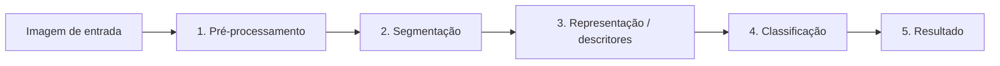

# Detecção de drones e aves em imagens via Processamento Digital de Imagens

**Integrantes**

Cassiano Silveira, Luis Gustavo Ribeiro e Pedro Henrique Coelho
#
**Problemas Investigados**

Áreas com espaço aéreo restrito precisam constantemente verificar quais objetos voadores estão presentes no ambiente, e os falsos alarmes são bem comuns, pois há um certo desafio em diferenciar animais, aves no geral com raras exceções, de objetos mecânicos que requerem autorizações para atuarem nesses espaços. Em longas distâncias suas silhuetas podem ser bem similares, além de sombras e iluminação que dificultam ainda mais a identificação em imagens do céu.
#
**Contexto de Aplicação**

O projeto é aplicado no monitoramento do espaço aéreo, aplicado em áreas como aeroportos, parques de conservação ambiental, sedes governamentais, e entre outras onde a detecção de drones é uma ação crítica, mas que não deve alarmar a movimentação natural de aves.
#
**Objetivo Geral**

Desenvolver um pipeline de PDI com técnicas para segmentar os elementos presentes em imagens do céu, extrair descritores geométricos de forma e classificar objetos em drone ou ave, trazendo a quantidade total visualizada de cada um deles e os demarcando visualmente na imagem.
#
**Visão Resumida da Solução**

A imagem passará por:

1. Conversão para escala de cinza e suavização com filtro gaussiano.
2. Limiarização.
3. Identificação de contornos isolados e cálculo de métricas de forma.
4. Regras de diferenciação de estruturas.
5. Contagem e Demarcação



#
**Conjunto de Imagens**

O projeto usa um conjunto inicial de 15 imagens (disponíveis em: ./images/input)  com características e quantidades de elementos variadas como:

- Fundos de céu com cores diferentes
- Diferentes ângulos
- Diferentes quantidades de aves
- Presença de drone e ave
- Ausência de drone e ave
- Presença apenas do drone
- Presença apenas da ave

As imagens foram retiradas de diferentes fontes:

Dataset com imagens de drone (Kaggle)

- Nome do dataset: Accurate drone shapes/segmentation
- Autor: metavision
- Fonte original: [Kaggle](https://www.kaggle.com/datasets/metavision/accurate-drone-shapessegmentation) 
- Licença: [Creative Commons Attribution 4.0 International (CC BY 4.0)](https://creativecommons.org/licenses/by/4.0/)
- Modificações: Seleção de amostras, padronização de tamanho e binarização via PDI.

Dataset com imagens de pássaros (Kaggle)

- Nome do dataset: Accurate birds shapes/segmentation
- Autor: metavision
- Fonte original: [Kaggle](https://www.kaggle.com/datasets/metavision/accurate-birds-shapessegmentation) 
- Licença: [Creative Commons Attribution 4.0 International (CC BY 4.0)](https://creativecommons.org/licenses/by/4.0/)
- Modificações: Seleção de amostras, padronização de tamanho e binarização via PDI.

Algumas imagens foram retiradas de [Pexels](https://www.pexels.com) sob a [Licença Pexels](https://www.pexels.com/pt-br/licenca/).
#

**Estágio atual do projeto**

Como complemento à proposta da M1, foi preparado um script para medir manualmente as dimensões dos objetos nas 15 imagens, conforme a prioridade indicada pelo professor. A anotação ainda precisa ser executada; não há conclusão sobre a separabilidade entre aves e drones. O procedimento, a referência ao script e suas limitações estão na seção “Resposta ao feedback da M1” da [proposta](./docs/proposta.md).
#

**Organização do Repositório**

O repositório está sendo organizado no esquema:

```text
projeto-aplicado-longitudinal/
├── README.md
├── requirements.txt
├── src/
│   └── measure_objects.py
├── docs/
│   └── proposta.md
├── images/
│   ├── input/
│   └── results/
├── notebooks/           # quando aplicável
├── tests/               # quando aplicável
├── LICENSE              # quando aplicável
└── .gitignore
```
#

**Tecnologias Previstas**

- Linguagem: Python

- Bibliotecas: OpenCV

**Medição inicial**

O procedimento de anotação e interpretação está documentado na proposta. Para
executá-lo, crie um ambiente isolado e instale as dependências:

```bash
python3 -m venv .venv
.venv/bin/python -m pip install -r requirements.txt
.venv/bin/python src/measure_objects.py --annotate
.venv/bin/python src/measure_objects.py --analyze
```

O script grava as anotações em `data/object_annotations.csv` e gera as medidas
em `results/`. A área reportada é a da caixa delimitadora, não a área da
silhueta.
#
**Vídeo M1**

Acesso em:
[M1 - Detecção de drones e aves em imagens via PDI](https://youtu.be/x-ZY_v2nNL8?si=anc7oI2MPPl8rBiv)
#

**Documentação Adicional**

[Proposta](./docs/proposta.md)
