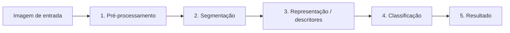

# Detecção de drones e aves em imagens via Processamento Digital de Imagens

**Integrantes**

Cassiano Silveira, Luis Gustavo Ribeiro e Pedro Henrique Coelho
#
**Problemas Investigados**

Áreas com espaço aéreo restrito precisam constantemente verificar quais objetos voadores estão presentes no ambiente, e os falsos alarmes são bem comuns, pois há um certo desafio em diferenciar animais, aves no geral com raras exceções, de objetos mecânicos que requerem autorizações para atuarem nesses espaços. Em longas distâncias suas silhuetas podem ser bem similares, além de sombras e iluminação que dificultam ainda mais a identificação em imagens do céu.
#
**Contexto de Aplicação**

O projeto é aplicado no monitoramento do espaço aéreo, aplicado em áreas como aeroportos, parques de conservação ambiental, sedes governamentais, e entre outras onde a detecção de drones é uma ação crítica, mas que não deve alarmar a movimentação natural de aves.
#
**Objetivo Geral**

Desenvolver um pipeline de PDI com técnicas para segmentar os elementos presentes em imagens do céu, extrair descritores geométricos de forma e classificar objetos em drone ou ave, trazendo a quantidade total visualizada de cada um deles e os demarcando visualmente na imagem.
#
**Visão Resumida da Solução**

A imagem passará por:

1. Conversão para escala de cinza e suavização com filtro gaussiano.
2. Limiarização.
3. Identificação de contornos isolados e cálculo de métricas de forma.
4. Regras de diferenciação de estruturas.
5. Contagem e Demarcação



#
**Conjunto de Imagens**

O projeto usa um conjunto inicial de 15 imagens (disponíveis em: ./images/input)  com características e quantidades de elementos variadas como:

- Fundos de céu com cores diferentes
- Diferentes ângulos
- Diferentes quantidades de aves
- Presença de drone e ave
- Ausência de drone e ave
- Presença apenas do drone
- Presença apenas da ave

As imagens foram retiradas de diferentes fontes:

Dataset com imagens de drone (Kaggle)

- Nome do dataset: Accurate drone shapes/segmentation
- Autor: metavision
- Fonte original: [Kaggle](https://www.kaggle.com/datasets/metavision/accurate-drone-shapessegmentation) 
- Licença: [Creative Commons Attribution 4.0 International (CC BY 4.0)](https://creativecommons.org/licenses/by/4.0/)
- Modificações: Seleção de amostras, padronização de tamanho e binarização via PDI.

Dataset com imagens de pássaros (Kaggle)

- Nome do dataset: Accurate birds shapes/segmentation
- Autor: metavision
- Fonte original: [Kaggle](https://www.kaggle.com/datasets/metavision/accurate-birds-shapessegmentation) 
- Licença: [Creative Commons Attribution 4.0 International (CC BY 4.0)](https://creativecommons.org/licenses/by/4.0/)
- Modificações: Seleção de amostras, padronização de tamanho e binarização via PDI.

Algumas imagens foram retiradas de [Pexels](https://www.pexels.com) sob a [Licença Pexels](https://www.pexels.com/pt-br/licenca/).
#

**Objetivo e entradas/saídas**

O projeto investiga como segmentar objetos em imagens de céu e se descritores
geométricos podem ajudar a diferenciar aves e drones. A entrada é uma imagem
JPEG em `images/input/`; a saída parcial da M2 contém máscaras binárias,
componentes com descritores, sobreposições e tabelas comparando dois
limiares. **A classificação final ave/drone não está implementada** e ainda
não há evidência suficiente para afirmar que as classes são separáveis.

**Estágio atual do projeto**

A M2 implementa pré-processamento, limiarização global/adaptativa, abertura
morfológica, análise de componentes conectados e extração de descritores. O
experimento foi executado nas 15 imagens existentes. As medidas de referência
completas para todos os objetos ainda precisam ser anotadas e revisadas. A
resposta detalhada ao feedback, protocolo, resultados, limitações e plano M3
está na [proposta](./docs/proposta.md).
#

**Organização do Repositório**

O repositório está sendo organizado no esquema:

```text
projeto-aplicado-longitudinal/
├── README.md
├── requirements.txt
├── src/
│   ├── measure_objects.py
│   └── run_experiment.py
├── docs/
│   └── proposta.md
├── data/
│   └── pilot_annotations.csv
├── results/
│   ├── segmentation_comparison.jpg
│   ├── segmentation_comparison.csv
│   ├── segmented_components.csv
│   ├── segmentation_experiment.md
│   └── masks/
├── tests/
│   └── test_run_experiment.py
├── images/
│   └── input/
│       ├── HighResolution/
│       └── LowResolution/
└── .gitignore
```
#

**Tecnologias e dependências verificadas**

- Python 3.12.3
- OpenCV 4.14.0.94
- NumPy 2.5.4

**Instalação**

```bash
python3 -m venv .venv
.venv/bin/python -m pip install -r requirements.txt
```

**Experimento reproduzível da M2**

Compare Otsu e o limiar adaptativo nas 15 imagens. A referência piloto incluída
é preliminar e precisa ser revisada pela equipe:

```bash
.venv/bin/python src/run_experiment.py --annotations data/pilot_annotations.csv
.venv/bin/python -m unittest discover -s tests -v
```

Para anotar manualmente todos os objetos e imagens sem objeto:

```bash
.venv/bin/python src/measure_objects.py --annotate
.venv/bin/python src/measure_objects.py --analyze
.venv/bin/python src/run_experiment.py --annotations data/object_annotations.csv
```

Os resultados ficam em `results/`: comparação por imagem, descritores dos
componentes, máscaras binárias para cada configuração, figura comparativa e
relatório experimental. A medição manual usa caixas delimitadoras, cuja área
inclui fundo e não equivale à área da silhueta.

Na execução atual, Otsu gerou 563 componentes candidatos e fração mediana de
primeiro plano 0,516868; o método adaptativo gerou 1891 candidatos e fração
mediana 0,002629. Estes são descritores da saída, não medidas de acurácia. No
piloto de duas imagens, com IoU >= 0,3, os F1 foram 0,250 (Otsu) e 1,000
(adaptativo); a amostra é pequena e a caixa de referência ainda aguarda revisão
independente, então não sustenta uma conclusão de desempenho.

**Dados**

O conjunto atual tem 15 imagens (4 em `HighResolution`, 11 em `LowResolution`).
As fontes citadas na proposta original são os datasets
[Accurate drone shapes/segmentation](https://www.kaggle.com/datasets/metavision/accurate-drone-shapessegmentation),
[Accurate birds shapes/segmentation](https://www.kaggle.com/datasets/metavision/accurate-birds-shapessegmentation)
(descritos nela como CC BY 4.0) e imagens [Pexels](https://www.pexels.com/pt-br/licenca/).
A origem individual e a licença de cada arquivo ainda não foram confirmadas.
Consulte o [inventário de imagens](./data/image_inventory.csv) e os passos na proposta;
não se deve presumir que todos os arquivos tenham a mesma origem ou licença.

**Documentação, evidências e itens pendentes**

- [Proposta e relatório técnico M2: feedback, decisões, resultados e plano M3](./docs/proposta.md)
- [Relatório gerado pelo experimento](./results/segmentation_experiment.md)
- [Figura da comparação](./results/segmentation_comparison.jpg)
- [Inventário de imagens e proveniência](./data/image_inventory.csv)
- [Roteiro do vídeo M2 para os três integrantes](./roteiro.md)
- Vídeo M1: [Detecção de drones e aves em imagens via PDI](https://youtu.be/x-ZY_v2nNL8?si=anc7oI2MPPl8rBiv)
- Vídeo M2: [M2 - Detecção de drones e aves em imagens via PDI](https://www.youtube.com/watch?v=g6J0GJzs50w)


Foi utilizado assistente de IA generativa via Copilot SDK no VS Code para apoiar
código, testes, anotação piloto e documentação. A declaração completa e os
limites dessa participação estão na proposta.
