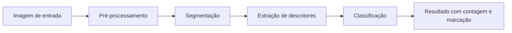
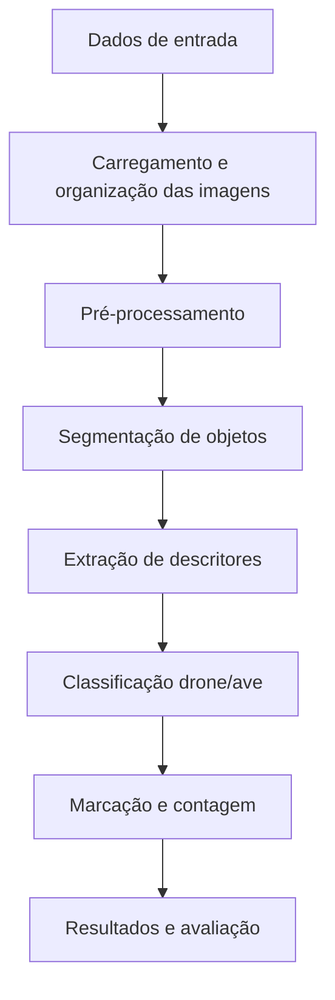

# Proposta do Projeto: Detecção de drones e aves em imagens de céu

## 1. Problema

O problema investigado neste projeto é a diferenciação entre drones e aves em imagens de ambiente aéreo, especialmente em cenários em que o fundo é predominantemente o céu e os objetos ocupam pequena área na cena. A identificação correta é relevante em contextos como aeroportos, áreas de segurança governamental, parques ambientais e instalações com restrição de espaço aéreo, onde a presença de drones pode exigir atenção imediata, enquanto o movimento de aves normalmente não deve desencadear alarmes.

A dificuldade principal está no fato de que, em imagens de longa distância, drones e aves podem apresentar silhuetas semelhantes, além de sofrerem influencia de iluminação, sombreamento, baixa resolução, ruído e variação de perspectiva. Dessa forma, o problema envolve diretamente análise e processamento de imagens, pois a informação relevante não está apenas na intensidade dos pixels, mas também em características visuais de forma, borda, contorno, proporção e contexto da cena.

A situação inicial é a existência de um conjunto de imagens representativas do céu, em que pode haver presença de drones, de aves ou de ambos. A partir dessas imagens, a meta é produzir uma saída que indique, para cada objeto detectado, se ele é classificado como drone ou ave, além de contar quantos objetos de cada categoria aparecem na imagem e marcá-los visualmente.

## 2. Contexto de aplicação

A solução proposta pode ser aplicada em sistemas de vigilância e monitoramento de espaço aéreo. Em aeroportos, por exemplo, um drone próximo à pista pode representar risco, enquanto uma ave voando nas mesmas condições pode ser um evento cotidiano. O mesmo problema aparece em condomínios, instalações industriais, áreas protegidas e centros militares, onde é necessário distinguir movimentos naturais de objetos potencialmente hostis.

Mesmo que o projeto não resulte em um produto comercial pronto, ele se encaixa em um contexto de uso concreto e verificável, permitindo avaliar se a ideia é viável em termos de processamento, precisão e robustez em imagens reais. Além disso, a classificação por características geométricas é uma abordagem compatível com a disciplina de Processamento Digital de Imagens e com projetos de extensão do tipo longitudinal.

## 3. Objetivo

### Objetivo geral

Desenvolver um pipeline de processamento de imagens para detectar objetos voadores em cenas de céu, extrair descritores relevantes de forma e classificar cada objeto como drone ou ave, produzindo contagem e demarcação visual dos elementos identificados.

### Objetivos específicos

- selecionar e organizar um conjunto inicial de imagens representativas;
- realizar pré-processamento para reduzir ruído e melhorar contraste;
- segmentar os objetos de interesse presentes na cena;
- extrair descritores geométricos e estruturais dos contornos;
- avaliar regras ou classificadores simples para distinguir estrutura de drone e ave;
- produzir uma saída visual com marcações e contagem dos objetos detectados.

## 4. Entrada e saída esperadas

### Entrada

A entrada do sistema será uma imagem 2D de ambiente aéreo, contendo céu em diferentes condições de iluminação, com um ou mais objetos voadores. As imagens podem variar em resolução, presença de sombras, ângulo de visão e quantidade de objetos.

### Saída esperada

O sistema deve produzir uma resposta que inclua:

- identificação dos objetos detectados na imagem;
- marcação visual desses objetos no formato de bounding boxes, contornos ou indicadores;
- classificação de cada objeto como “drone” ou “ave”;
- contagem total de drones e aves presentes na cena;
- eventualmente, uma indicação de confiabilidade ou de dúvida em casos ambíguos.

A sequência esperada pode ser resumida da seguinte forma:



## 5. Imagens e dados

O conjunto inicial de dados do projeto está composto por 15 imagens armazenadas em `images/input`, com variação em:

- fundo de céu com tonalidades diferentes;
- presença ou ausência de aves;
- presença ou ausência de drones;
- número variado de objetos por cena;
- diferentes ângulos de captura;
- diferentes níveis de contraste e iluminação.

Essas imagens foram selecionadas para representar cenários relevantes ao
problema e permitir uma caracterização preliminar dos dados. Ainda não há
referência anotada por objeto nem validação do pipeline.

### Origem das imagens

As imagens foram obtidas a partir de fontes públicas e acessíveis em conjunto com adaptações de processamento para uso acadêmico:

- Dataset de drones: “Accurate drone shapes/segmentation” no Kaggle;
- Dataset de aves: “Accurate birds shapes/segmentation” no Kaggle;
- algumas imagens adicionais foram coletadas em fontes públicas com licença compatível para uso educacional e pesquisa.

### Informações relevantes

- quantidade inicial disponível: 15 imagens;
- formatos: imagens em formato comum de imagens digitais, como JPG;
- uso: conjunto inicial para desenvolvimento da proposta e dos experimentos preliminares;
- restrições: as imagens devem ser utilizadas apenas para fins do projeto acadêmico e conforme as licenças das fontes;
- documentação: o conjunto foi organizado em pasta específica e será expandido durante as etapas posteriores do projeto.

## 6. Pipeline preliminar

A hipótese técnica do projeto é que objetos voadores podem ser separados do fundo por segmentação e diferenciados por características de forma e contorno, em vez de depender apenas de classificação direta da imagem inteira.

### 6.1 Pré-processamento

- finalidade: reduzir ruído, melhorar contraste e facilitar a separação dos objetos do céu;
- técnicas consideradas: conversão para escala de cinza, equalização de histograma, filtros suaves e limiarização adaptativa;
- entrada: imagem original em RGB;
- saída: imagem mais homogênea para a etapa de segmentação.

### 6.2 Segmentação

- finalidade: isolar regiões que representem objetos voadores;
- técnicas consideradas: limiarização por intensidade, detecção de contornos, segmentação por diferença de fundo e algoritmos de extração de regiões;
- entrada: imagem pré-processada;
- saída: máscaras ou regiões binárias correspondentes aos objetos.

### 6.3 Extração de descritores

- finalidade: representar cada objeto por atributos que ajudem a distingui-lo;
- técnicas consideradas: área, perímetro, relação largura/altura, circularidade, convexidade, compactação e outros descritores geométricos;
- entrada: região segmentada;
- saída: vetor de características para cada objeto.

### 6.4 Classificação

- finalidade: decidir se o objeto é ave ou drone;
- técnicas consideradas: regras heurísticas baseadas em forma, comparação por descritores e, futuramente, classificadores mais robustos;
- entrada: descritores do objeto;
- saída: classe atribuída (drone ou ave).

### 6.5 Resultados e marcação

- finalidade: apresentar ao usuário o resultado da análise em formato interpretável;
- técnicas consideradas: desenho de contornos, boxes delimitadoras e contagem por categoria;
- entrada: objetos detectados e classes;
- saída: imagem final com objetos demarcados e contagem do total em cada classe.

### Alternativas e incertezas

Ainda existem dúvidas em relação ao melhor conjunto de atributos para diferenciar drones e aves. Em geral, aves apresentam silhuetas mais orgânicas e variações de envergadura, enquanto drones tendem a apresentar formas mais rígidas, simétricas e com estruturas definidas. No entanto, dependendo da distância e do ângulo, essas diferenças podem se sobrepor. Por isso, a etapa de extração de descritores e classificação será estudada e comparada com diferentes abordagens durante o desenvolvimento da proposta.

## 7. Arquitetura preliminar

A arquitetura do projeto será organizada em etapas bem definidas, mantendo um fluxo que possa evoluir ao longo da disciplina.



A estrutura prevista do projeto inclui:

- diretório de imagens de entrada;
- documentação técnica em Markdown;
- scripts ou notebooks para processamento experimental;
- resultados intermediários em pasta específica;
- organização modular para facilitar a expansão para métodos mais sofisticados na M2 e M3.

## 8. Estudo inicial de viabilidade

A proposta é viável como investigação incremental, mas a viabilidade da
classificação ainda depende de evidência experimental:

- a inspeção visual confirma a presença de objetos de interesse, mas ainda não demonstra que há resolução suficiente para descrevê-los geometricamente nem que aves e drones sejam separáveis;
- o problema envolve processamento e análise de imagens de maneira direta, sem depender de dados complexos ou de sensores especializados;
- existem bibliotecas e métodos bem estabelecidos em visão computacional, especialmente em OpenCV, que permitem realizar pré-processamento, limiarização, segmentação e extração de contornos;
- a diferença entre objetos voadores e o fundo do céu motiva a hipótese de uma abordagem baseada em segmentação e descritores, que precisa ser testada;
- o projeto é compatível com evolução longitudinal, pois a etapa inicial pode ser focada em segmentação e classificação simples, enquanto a segunda e terceira etapas podem incluir refinamentos, análise mais detalhada e testes de técnicas mais robustas.

Além disso, a literatura técnica disponível e a documentação das bibliotecas mostram que técnicas de processamento de imagens podem ser aplicadas a este problema quando os objetos têm pixels suficientes para permitir a extração de atributos geométricos. A adequação dessa condição para as imagens do projeto ainda será verificada.

## 9. Resultados e experimentos preliminares

Até o momento, a investigação inicial foi focada na seleção do conjunto de imagens e no desenho da metodologia. Não houve implementação completa do sistema, mas os primeiros passos relevantes incluem:

- organização do conjunto inicial de imagens em `images/input`;
- inspeção visual das cenas para identificar exemplos e limitações aparentes, sem validar a separabilidade;
- definição da sequência lógica de processamento para a etapa M1.

### Resposta ao feedback da M1

O feedback apontou como prioridade imediata medir a área e as dimensões dos
objetos nas 15 imagens, antes de ampliar o conjunto ou concluir que descritores
geométricos podem distinguir aves e drones. Na M1, não foram medidos os objetos
individualmente nem criada uma referência estruturada por objeto.

Para atender a essa prioridade, foi criado o script
[`src/measure_objects.py`](../src/measure_objects.py). Ele permite desenhar
manualmente uma caixa delimitadora em cada objeto e registrar sua classe
(`bird` ou `drone`). A partir das coordenadas anotadas, calcula largura e altura
em pixels, área da caixa, proporção entre largura e altura, menor lado e
percentual da imagem ocupado pela caixa. Imagens sem objeto também precisam ser
explicitamente confirmadas como revisadas.

Para executar, instale as dependências e rode:

```bash
python3 -m venv .venv
.venv/bin/python -m pip install -r requirements.txt
.venv/bin/python src/measure_objects.py --annotate
.venv/bin/python src/measure_objects.py --analyze
```

As anotações são gravadas em `data/object_annotations.csv`; a execução da
análise gera uma tabela por objeto (`results/object_measurements.csv`) e um
resumo descritivo (`results/measurement_summary.md`). A caixa delimitadora
inclui pixels de fundo e, portanto, sua área não equivale à área da silhueta.
As medidas em pixels também dependem da resolução, distância e enquadramento da
imagem.

**Estado e limite da evidência:** o script está implementado, mas a anotação
manual ainda precisa ser executada e revisada pelos integrantes. Portanto, não
há resultados quantitativos dos objetos nem conclusão de que as classes sejam
separáveis. A inspeção visual confirma apenas a presença de exemplos e a
variação entre imagens; não substitui a medição nem a validação. Esse
procedimento atende à prioridade de caracterizar o tamanho aparente dos
objetos, mas não testa, por si só, a segmentação ou a classificação.

Após essa medição, o plano experimental é testar:

- conversão para escala de cinza;
- suavização com filtro Gaussiano;
- limiarização por intensidade ou adaptativa;
- detecção de contornos e preenchimento de regiões;
- cálculo de descritores geométricos por objeto;
- comparação entre regras simples e classificadores básicos.

Esses experimentos devem verificar se as imagens selecionadas possuem informação suficiente para sustentar a abordagem de diferenciação entre drone e ave; até sua execução, essa viabilidade permanece uma hipótese.

## 10. Referências

- Kaggle — Accurate drone shapes/segmentation.
- Kaggle — Accurate birds shapes/segmentation.
- OpenCV Documentation.
- Processamento Digital de Imagens e técnicas de segmentação, contorno e descritores geométricos.
- Material didático da disciplina de Processamento de Imagens.

## 11. Considerações finais

Este projeto apresenta um problema delimitado, um conjunto inicial de imagens e uma estratégia técnica a investigar. A M1 consolidou a proposta; a M2 iniciou a implementação e a caracterização dos dados. A suficiência da resolução e a separabilidade das classes ainda precisam de evidência experimental.

A evolução esperada para M2 e M3 inclui a implementação do pipeline proposto, comparação de métodos, refinamento da segmentação, testes com descritores mais robustos e validação da classificação de drones e aves em imagens reais.

## 12. Declaração de uso de IA

Não houve uso de inteligência artificial generativa para a produção do conteúdo principal desta proposta. O documento foi elaborado com base na investigação do problema, nas imagens selecionadas e nas diretrizes da disciplina.
