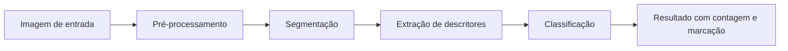
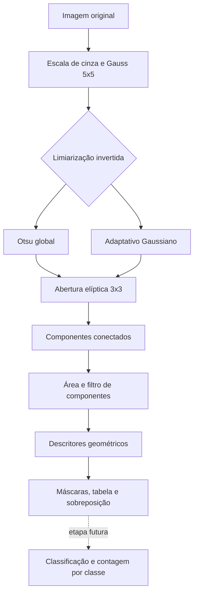
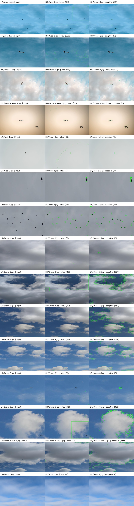

# Proposta do Projeto: Detecção de drones e aves em imagens de céu

## 1. Problema

O problema investigado neste projeto é a diferenciação entre drones e aves em imagens de ambiente aéreo, especialmente em cenários em que o fundo é predominantemente o céu e os objetos ocupam pequena área na cena. A identificação correta é relevante em contextos como aeroportos, áreas de segurança governamental, parques ambientais e instalações com restrição de espaço aéreo, onde a presença de drones pode exigir atenção imediata, enquanto o movimento de aves normalmente não deve desencadear alarmes.

A dificuldade principal está no fato de que, em imagens de longa distância, drones e aves podem apresentar silhuetas semelhantes, além de sofrerem influencia de iluminação, sombreamento, baixa resolução, ruído e variação de perspectiva. Dessa forma, o problema envolve diretamente análise e processamento de imagens, pois a informação relevante não está apenas na intensidade dos pixels, mas também em características visuais de forma, borda, contorno, proporção e contexto da cena.

A situação inicial é a existência de um conjunto de imagens representativas do céu, em que pode haver presença de drones, de aves ou de ambos. A partir dessas imagens, a meta é produzir uma saída que indique, para cada objeto detectado, se ele é classificado como drone ou ave, além de contar quantos objetos de cada categoria aparecem na imagem e marcá-los visualmente.

## 2. Contexto de aplicação

A solução proposta pode ser aplicada em sistemas de vigilância e monitoramento de espaço aéreo. Em aeroportos, por exemplo, um drone próximo à pista pode representar risco, enquanto uma ave voando nas mesmas condições pode ser um evento cotidiano. O mesmo problema aparece em condomínios, instalações industriais, áreas protegidas e centros militares, onde é necessário distinguir movimentos naturais de objetos potencialmente hostis.

Mesmo que o projeto não resulte em um produto comercial pronto, ele se encaixa em um contexto de uso concreto e verificável, permitindo avaliar se a ideia é viável em termos de processamento, precisão e robustez em imagens reais. Além disso, a classificação por características geométricas é uma abordagem compatível com a disciplina de Processamento Digital de Imagens e com projetos de extensão do tipo longitudinal.

## 3. Objetivo

### Objetivo geral

Desenvolver um pipeline de processamento de imagens para detectar objetos voadores em cenas de céu, extrair descritores relevantes de forma e classificar cada objeto como drone ou ave, produzindo contagem e demarcação visual dos elementos identificados.

### Objetivos específicos

- selecionar e organizar um conjunto inicial de imagens representativas;
- realizar pré-processamento para reduzir ruído e melhorar contraste;
- segmentar os objetos de interesse presentes na cena;
- extrair descritores geométricos e estruturais dos contornos;
- avaliar regras ou classificadores simples para distinguir estrutura de drone e ave;
- produzir uma saída visual com marcações e contagem dos objetos detectados.

## 4. Entrada e saída esperadas

### Entrada

A entrada do sistema será uma imagem 2D de ambiente aéreo, contendo céu em diferentes condições de iluminação, com um ou mais objetos voadores. As imagens podem variar em resolução, presença de sombras, ângulo de visão e quantidade de objetos.

### Saída esperada

O sistema deve produzir uma resposta que inclua:

- identificação dos objetos detectados na imagem;
- marcação visual desses objetos no formato de bounding boxes, contornos ou indicadores;
- classificação de cada objeto como “drone” ou “ave”;
- contagem total de drones e aves presentes na cena;
- eventualmente, uma indicação de confiabilidade ou de dúvida em casos ambíguos.

A sequência esperada pode ser resumida da seguinte forma:



## 5. Imagens e dados

O conjunto inicial de dados do projeto está composto por 15 imagens armazenadas em `images/input`, com variação em:

- fundo de céu com tonalidades diferentes;
- presença ou ausência de aves;
- presença ou ausência de drones;
- número variado de objetos por cena;
- diferentes ângulos de captura;
- diferentes níveis de contraste e iluminação.

Essas imagens foram selecionadas para representar cenários relevantes ao
problema e permitir uma caracterização preliminar dos dados. Ainda não há
referência anotada por objeto nem validação do pipeline.

### Origem das imagens

Na documentação da M1, foram citadas fontes públicas para o conjunto, mas a
procedência de cada arquivo ainda não foi verificada:

- Dataset de drones: “Accurate drone shapes/segmentation” no Kaggle;
- Dataset de aves: “Accurate birds shapes/segmentation” no Kaggle;
- algumas imagens adicionais foram coletadas em fontes públicas com licença compatível para uso educacional e pesquisa.

As páginas citadas na M1 são [Accurate drone shapes/segmentation no Kaggle](https://www.kaggle.com/datasets/metavision/accurate-drone-shapessegmentation),
[Accurate birds shapes/segmentation no Kaggle](https://www.kaggle.com/datasets/metavision/accurate-birds-shapessegmentation)
(descritas na proposta original como CC BY 4.0) e a página geral da
[licença Pexels](https://www.pexels.com/pt-br/licenca/). Essas referências não
confirmam que qualquer arquivo específico veio desses locais nem qual licença
se aplica a ele.

Para registrar essa conferência, o arquivo
[`data/image_inventory.csv`](../data/image_inventory.csv) lista cada imagem,
dimensões e campos para fonte, URL original, autoria/crédito, licença,
modificações, condições de captura e estado da verificação. No estado atual,
as dimensões foram medidas, mas todas as origens individuais permanecem
pendentes. Os nomes de arquivo, pastas e rótulos sugeridos não comprovam a
origem, a classe nem o direito de redistribuição.

Antes da entrega, para cada arquivo, o grupo deve:

1. localizar a página exata do arquivo original no dataset ou site de origem;
2. confirmar a correspondência entre o original e a cópia do repositório,
   registrando se houve recorte, redimensionamento, binarização ou conversão;
3. anotar autor/criador, URL e licença aplicável ao arquivo (não presumir que
   todas as imagens têm a licença CC BY 4.0);
4. verificar se a licença permite redistribuir a cópia no repositório público
   e cumprir a atribuição exigida. Se isso não puder ser confirmado, remover a
   imagem do repositório e documentar como obtê-la legalmente, ou substituí-la
   por uma imagem cuja licença possa ser verificada;
5. identificar condições conhecidas de captura (resolução original, fonte,
   data/local se publicados, recortes e limitações), deixando explícito o que
   não for conhecido;
6. revisar a classe e anotar cada objeto e imagens vazias separadamente. O
   nome do arquivo é apenas sugestão e não substitui referência visual revisada.

Se o arquivo original tiver sido obtido do Kaggle, compare com os arquivos do
dataset efetivamente baixado e registre a versão/conjunto e o nome original.
Para imagens do Pexels, localize a página individual e o criador; a página
genérica da licença não prova a procedência daquela foto. Não atribua origem
com base apenas em semelhança visual.

### Informações relevantes

- quantidade inicial disponível: 15 imagens;
- formatos: imagens em formato comum de imagens digitais, como JPG;
- uso: conjunto inicial para desenvolvimento da proposta e dos experimentos preliminares;
- restrições: as imagens devem ser utilizadas apenas para fins do projeto acadêmico e conforme as licenças das fontes;
- documentação: o conjunto foi organizado em pasta específica e será expandido durante as etapas posteriores do projeto.

## 6. Pipeline preliminar

A hipótese técnica do projeto é que objetos voadores podem ser separados do fundo por segmentação e diferenciados por características de forma e contorno, em vez de depender apenas de classificação direta da imagem inteira.

### 6.1 Pré-processamento

- finalidade: reduzir ruído, melhorar contraste e facilitar a separação dos objetos do céu;
- técnicas consideradas: conversão para escala de cinza, equalização de histograma, filtros suaves e limiarização adaptativa;
- entrada: imagem original em RGB;
- saída: imagem mais homogênea para a etapa de segmentação.

### 6.2 Segmentação

- finalidade: isolar regiões que representem objetos voadores;
- técnicas consideradas: limiarização por intensidade, detecção de contornos, segmentação por diferença de fundo e algoritmos de extração de regiões;
- entrada: imagem pré-processada;
- saída: máscaras ou regiões binárias correspondentes aos objetos.

### 6.3 Extração de descritores

- finalidade: representar cada objeto por atributos que ajudem a distingui-lo;
- técnicas consideradas: área, perímetro, relação largura/altura, circularidade, convexidade, compactação e outros descritores geométricos;
- entrada: região segmentada;
- saída: vetor de características para cada objeto.

### 6.4 Classificação

- finalidade: decidir se o objeto é ave ou drone;
- técnicas consideradas: regras heurísticas baseadas em forma, comparação por descritores e, futuramente, classificadores mais robustos;
- entrada: descritores do objeto;
- saída: classe atribuída (drone ou ave).

### 6.5 Resultados e marcação

- finalidade: apresentar ao usuário o resultado da análise em formato interpretável;
- técnicas consideradas: desenho de contornos, boxes delimitadoras e contagem por categoria;
- entrada: objetos detectados e classes;
- saída: imagem final com objetos demarcados e contagem do total em cada classe.

### Alternativas e incertezas

Ainda existem dúvidas em relação ao melhor conjunto de atributos para diferenciar drones e aves. Em geral, aves apresentam silhuetas mais orgânicas e variações de envergadura, enquanto drones tendem a apresentar formas mais rígidas, simétricas e com estruturas definidas. No entanto, dependendo da distância e do ângulo, essas diferenças podem se sobrepor. Por isso, a etapa de extração de descritores e classificação será estudada e comparada com diferentes abordagens durante o desenvolvimento da proposta.

## 7. Arquitetura preliminar

A arquitetura parcial executada na M2 percorre da imagem aos componentes
segmentados e descritos. A classificação por classe e a contagem final ainda
não fazem parte da implementação.



O script [`src/run_experiment.py`](../src/run_experiment.py) implementa e
compara as duas configurações em `images/input`. Ambas usam conversão para
escala de cinza, filtro Gaussiano 5 x 5, limiarização binária invertida,
abertura morfológica com elipse 3 x 3 e filtragem de componentes com área entre
4 pixels e 25% da imagem processada. A diferença controlada é o limiar:
automático global de Otsu ou adaptativo Gaussiano local (bloco 31 x 31, C=5).
Imagens são reduzidas proporcionalmente, quando necessário, para que o maior
lado tenha no máximo 1280 pixels.

O script mede componentes conectados e exporta área, caixa delimitadora,
proporção largura/altura, perímetro, circularidade e solidez. Os valores de
componentes e perímetro estão em pixels na escala reduzida de processamento;
as caixas desenhadas na figura são convertidas de volta para a resolução
original. Circularidade é `4π × área_do_contorno / perímetro²`; solidez é
`área_do_contorno / área_do_hull_convexo`. As saídas incluem máscaras binárias,
tabela CSV por imagem, tabela de descritores, figura comparativa e relatório.

O script [`src/measure_objects.py`](../src/measure_objects.py) complementa esse
fluxo com anotação manual de caixas de referência e medidas em pixels da imagem
original. A segmentação não usa essas caixas para produzir as máscaras; elas
podem ser usadas depois para uma avaliação piloto de localização.

## 8. Estudo inicial de viabilidade

A proposta é viável como investigação incremental, mas a viabilidade da
classificação ainda depende de evidência experimental:

- a inspeção visual confirma a presença de objetos de interesse, mas ainda não demonstra que há resolução suficiente para descrevê-los geometricamente nem que aves e drones sejam separáveis;
- o problema envolve processamento e análise de imagens de maneira direta, sem depender de dados complexos ou de sensores especializados;
- existem bibliotecas e métodos bem estabelecidos em visão computacional, especialmente em OpenCV, que permitem realizar pré-processamento, limiarização, segmentação e extração de contornos;
- a diferença entre objetos voadores e o fundo do céu motiva a hipótese de uma abordagem baseada em segmentação e descritores, que precisa ser testada;
- o projeto é compatível com evolução longitudinal, pois a etapa inicial pode ser focada em segmentação e classificação simples, enquanto a segunda e terceira etapas podem incluir refinamentos, análise mais detalhada e testes de técnicas mais robustas.

Além disso, a literatura técnica disponível e a documentação das bibliotecas mostram que técnicas de processamento de imagens podem ser aplicadas a este problema quando os objetos têm pixels suficientes para permitir a extração de atributos geométricos. A adequação dessa condição para as imagens do projeto ainda será verificada.

## 9. Resultados e experimentos da M2

A versão M2 executa o mesmo processamento em 15 imagens (4 em
`HighResolution` e 11 em `LowResolution`). O conjunto é exploratório: inclui
fundo azul e nublado, aves, drones, uma cena com ambos e uma cena sem objeto.
As resoluções variam de 504 × 187 a 6240 × 4160 pixels. As imagens estão
organizadas por pastas chamadas `HighResolution` e `LowResolution`. A proposta
da M1 citava datasets Kaggle de aves e drones e imagens Pexels, mas essa
associação não foi confirmada para cada arquivo. A origem individual, licença
e condições de captura ainda precisam ser verificadas e documentadas pelo
grupo; a pasta não é uma amostra representativa de uso real.

- organização do conjunto inicial de imagens em `images/input`; na M1 ainda não havia implementação de processamento;
- inspeção das imagens típicas e difíceis, sem tomar seus nomes como referência definitiva de classificação;
- primeira implementação de segmentação, análise de componentes e descritores, criada na M2 em `src/run_experiment.py`;
- criação dos testes unitários em `tests/test_run_experiment.py`.

### Resposta ao feedback da M1

O feedback apontou como prioridade imediata medir a área e as dimensões dos
objetos nas 15 imagens, antes de ampliar o conjunto ou concluir que descritores
geométricos podem distinguir aves e drones. A entrega M1 continha proposta e
imagens, mas não implementação de processamento, medidas individuais ou
referência estruturada por objeto.

Para atender a essa prioridade, foi criado o script
[`src/measure_objects.py`](../src/measure_objects.py). Ele permite desenhar
manualmente uma caixa delimitadora em cada objeto e registrar sua classe
(`bird` ou `drone`). A partir das coordenadas anotadas, calcula largura e altura
em pixels, área da caixa, proporção entre largura e altura, menor lado e
percentual da imagem ocupado pela caixa. Imagens sem objeto também precisam ser
explicitamente confirmadas como revisadas.

Para executar, instale as dependências e rode:

```bash
python3 -m venv .venv
.venv/bin/python -m pip install -r requirements.txt
.venv/bin/python src/measure_objects.py --annotate
.venv/bin/python src/measure_objects.py --analyze
```

As anotações completas são gravadas em `data/object_annotations.csv`; a
execução da análise gera uma tabela por objeto
(`results/object_measurements.csv`) e um resumo descritivo
(`results/measurement_summary.md`). A caixa delimitadora inclui pixels de fundo
e, portanto, sua área não equivale à área da silhueta. As medidas em pixels
também dependem da resolução, distância e enquadramento da imagem.

**Estado:** o script de medidas manuais está pronto, mas ainda não existe
anotação revisada de todos os objetos nas 15 imagens. A tabela de tamanho por
objeto está, portanto, pendente; a medição não permite ainda concluir se há
resolução geométrica suficiente nem se as classes são separáveis.

### Pergunta experimental

Nas mesmas imagens, o limiar adaptativo Gaussiano reduz o fundo segmentado sem
perder os objetos em relação ao limiar global de Otsu? Variam apenas o método
de limiarização; escala, suavização, morfologia e filtro de área são mantidos.
O critério de sucesso da implementação parcial é processar todas as 15
imagens, exportar máscaras e descritores reproduzíveis e comparar ambos os
métodos nas mesmas entradas. Isso verifica a execução e permite identificar
falhas; não define um limiar de acurácia, pois a referência completa ainda não
existe.
O procedimento reproduzível é:

```bash
.venv/bin/python src/run_experiment.py --annotations data/pilot_annotations.csv
```

O conjunto integral de resultados por imagem está em
[`results/segmentation_experiment.md`](../results/segmentation_experiment.md),
com tabela de descritores em
[`results/segmented_components.csv`](../results/segmented_components.csv) e
máscaras em `results/masks/`. A comparação visual está abaixo.



**Figura 1 —** Entrada (coluna esquerda), candidatos de Otsu (centro) e
candidatos adaptativos (direita). As caixas são hipóteses de componentes
segmentados, e não resultado de classificador. A inspeção mostra que fundos
com nuvens geram candidatos que não correspondem necessariamente a objetos.

### Resultados

| Configuração | Componentes nas 15 imagens | Mediana de componentes/imagem | Mediana da fração de pixels em primeiro plano |
|---|---:|---:|---:|
| Otsu global | 563 | 18 | 0,516868 |
| Adaptativo Gaussiano | 1891 | 18 | 0,002629 |

Essas contagens e frações descrevem a saída das máscaras, não medem acurácia:
ruído e nuvens também são componentes, e um objeto pode se fragmentar em mais
de um. O alto primeiro plano mediano de Otsu sugere forte confusão entre fundo
e objeto nesse conjunto. Já o limiar adaptativo apresenta fragmentação em
cenas com nuvens. Nenhuma configuração pode ser declarada melhor pela média
sem referência completa.

Foi feita uma avaliação piloto de caixas em duas imagens, indicada em
[`data/pilot_annotations.csv`](../data/pilot_annotations.csv). A caixa de ave
foi estimada por inspeção visual desta implementação e ainda requer revisão de
outro integrante; `Nada 1.jpg` foi revisada visualmente como cena sem objeto.
Com IoU mínimo de 0,3, os resultados preliminares foram:

| Configuração | TP | FP | FN | Precisão | Recall | F1 |
|---|---:|---:|---:|---:|---:|---:|
| Otsu global | 1 | 6 | 0 | 0,143 | 1,000 | 0,250 |
| Adaptativo Gaussiano | 1 | 0 | 0 | 1,000 | 1,000 | 1,000 |

**Leitura dos casos:** em `LowResolution/Aves 2.jpg`, ambos geram um componente
que coincide com a caixa piloto da ave (sucesso neste exemplo). Em
`LowResolution/Nada 1.jpg`, Otsu gera seis componentes candidatos falsos e o
adaptativo não gera nenhum (falha de Otsu e sucesso do adaptativo neste exemplo
negativo). Em `LowResolution/Drone 2.jpg`, o adaptativo gera 521 componentes,
um caso evidente de fragmentação/falsos candidatos em céu nublado. A métrica
piloto usa apenas duas imagens e uma caixa cuja revisão independente está
pendente; os valores não são evidência de desempenho generalizável,
classificação nem separabilidade entre as classes.

### Referência, limites e protocolo

O arquivo piloto serve para testar o cálculo da métrica e não substitui a
anotação completa solicitada pelo feedback. As caixas devem ser verificadas
por outro integrante; a classificação no CSV é `bird`/`drone`, mas as métricas
atuais avaliam apenas localização (pareamento IoU), ignorando a classe.
`data/object_annotations.csv` ainda não foi gerado. Os parâmetros de
limiarização não foram treinados: foram fixados antes da comparação. As 15
imagens foram todas usadas na exploração dos parâmetros; não há conjunto
reservado de teste, e a avaliação piloto não constitui divisão treino/teste.
Também não se sabe quais imagens compartilham origem/cena. Assim, os resultados
são exploratórios e não devem ser interpretados como teste independente.

Principais limitações: o pipeline usa intensidade de cinza e supõe objetos mais
escuros que o entorno; nuvens, sombras e gradientes quebram essa suposição; a
abertura 3 x 3 e área mínima de 4 pixels podem eliminar detalhes pequenos; a
redução para até 1280 px acelera o processamento, mas pode apagar objetos de
baixa resolução. O classificador drone/ave, a contagem final por classe e a
segmentação de silhuetas continuam pendentes.

### Escopo da classificação

A classificação final não foi implementada nesta etapa. Isso é compatível com
o enunciado da M2, que permite deixar a inferência final ou o classificador
completo em desenvolvimento, desde que haja plano concreto para a M3. Neste
projeto, classificar agora seria prematuro: as origens e os rótulos por objeto
ainda não estão verificados, a referência completa não existe e há somente 15
imagens. Um modelo avaliado nesse cenário poderia memorizar as poucas amostras
e produzir uma impressão enganosa de desempenho. Na M3, após revisar as
anotações e separar dados por imagem de origem, comparar um baseline simples
baseado em descritores e um classificador leve, com resultados por classe e
análise de erros.

### Plano de conclusão para a M3

| Tarefa | Responsável | Evidência esperada |
|---|---|---|
| Revisar e anotar objetos e cenas vazias nas 15 imagens | Equipe; divisão individual a definir | `data/object_annotations.csv` revisado por segundo integrante e tabela de dimensões |
| Identificar a fonte/licença por imagem e revisar seleção | Equipe; divisão individual a definir | Inventário com arquivo, URL de origem, licença e condição de captura |
| Avaliar segmentação contra referências e ajustar parâmetros sem contaminar o teste | Equipe; divisão individual a definir | Protocolo de treino/validação/teste por imagem de origem, IoU/precisão/recall e casos de falha |
| Testar descritores e classificador leve para ave/drone após validar rótulos e divisão dos dados | Equipe; divisão individual a definir | Métricas por classe, comparação baseline e matriz de confusão |
| Atualizar repositório, demonstração e apresentação final | Todos os integrantes | README, contribuições e vídeo com execução real e participação de todos |

A divisão nominal de tarefas, as contribuições individuais da M2 e o link do
vídeo M2 devem ser preenchidos pelos integrantes antes da entrega; não foram
inferidos nesta implementação.

### Registro de contribuições da equipe

| Integrante | Contribuição M2 | Evidência a registrar |
|---|---|---|
| Cassiano Silveira | A preencher pela equipe | Arquivo, anotação, experimento ou revisão realizada |
| Luis Gustavo Ribeiro | A preencher pela equipe | Arquivo, anotação, experimento ou revisão realizada |
| Pedro Henrique Coelho | A preencher pela equipe | Arquivo, anotação, experimento ou revisão realizada |

O grupo deve substituir os campos pendentes por contribuições efetivamente
realizadas. Esta tabela não presume autoria a partir de commits ou do uso de
ferramentas.

## 10. Referências

- Kaggle — [Accurate drone shapes/segmentation](https://www.kaggle.com/datasets/metavision/accurate-drone-shapessegmentation).
- Kaggle — [Accurate birds shapes/segmentation](https://www.kaggle.com/datasets/metavision/accurate-birds-shapessegmentation).
- Pexels — [licença de uso](https://www.pexels.com/pt-br/licenca/).
- OpenCV — [documentação de thresholding](https://docs.opencv.org/4.x/d7/d4d/tutorial_py_thresholding.html),
  [operações morfológicas](https://docs.opencv.org/4.x/d9/d61/tutorial_py_morphological_ops.html)
  e [componentes conectados](https://docs.opencv.org/4.x/d3/dc0/group__imgproc__shape.html).
- Processamento Digital de Imagens e técnicas de segmentação, contorno e descritores geométricos.
- Material didático da disciplina de Processamento de Imagens.

## 11. Considerações finais

Este projeto apresenta um problema delimitado, um conjunto inicial de imagens e uma estratégia técnica a investigar. A M1 consolidou a proposta; a M2 iniciou a implementação e a caracterização dos dados. A suficiência da resolução e a separabilidade das classes ainda precisam de evidência experimental.

A evolução esperada para M2 e M3 inclui a implementação do pipeline proposto, comparação de métodos, refinamento da segmentação, testes com descritores mais robustos e validação da classificação de drones e aves em imagens reais.

## 12. Declaração de uso de IA

Foi utilizado um assistente de IA generativa via Copilot SDK no VS Code como
apoio à implementação e aos testes dos scripts Python, à preparação da
anotação piloto, à execução exploratória das imagens e à revisão desta
documentação. A equipe deve revisar o código, a caixa piloto e as interpretações
antes da entrega. As imagens originais não foram alteradas; máscaras e figuras
foram geradas pelo pipeline descrito.
